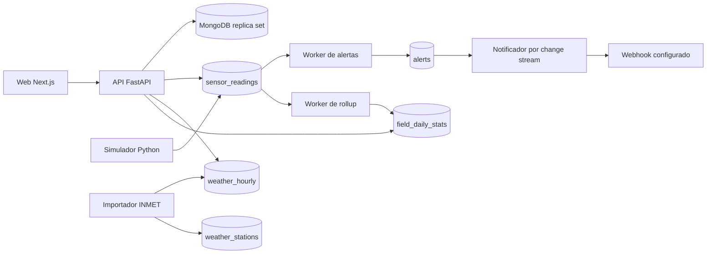

# AgroPulse

Plataforma de monitoramento de safras que reúne telemetria de sensores, alertas e dados climáticos. Projeto prático de Banco de Dados NoSQL.

## Contexto e problema

AgroPulse organiza leituras de sensores e informações climáticas para acompanhar talhões, consultar séries históricas e identificar condições que exigem atenção.

## Funcionalidades principais

- Cadastro de fazendas, talhões, sensores, operações e regras de alerta.
- Simulação de leituras históricas e atualizações contínuas de sensores.
- Avaliação periódica de regras e registro de alertas.
- Importação de dados climáticos do INMET.
- Pré-agregação diária por talhão para consultas do dashboard.
- Web opcional de automação com n8n para encaminhar alertas.

## Arquitetura



## Stack e decisões técnicas

| Área | Tecnologias e decisões |
| --- | --- |
| Web | Next.js e Tailwind |
| API | FastAPI e PyMongo assíncrono |
| Dados | MongoDB 7, collections time series, índices geoespaciais e agregações |
| Processamento | Workers Python para simulação, alertas, importação INMET e rollup |
| Ambiente | Docker Compose; n8n é opcional |

O replica set permite usar change streams para notificar alertas. Leituras e clima são armazenados em collections time series; o rollup grava agregações diárias em `field_daily_stats`.

## Como executar localmente

Pré-requisito: Docker com Compose.

```bash
make setup
make up
make seed
```

Após a carga inicial, o simulador cria sete dias de histórico e passa a inserir leituras ao vivo. A carga local cria a conta de demonstração `demo@agropulse.dev` com senha `demo12345`.

| Serviço | Endereço local |
| --- | --- |
| Web | http://localhost:3000 |
| API e Swagger | http://localhost:8000/docs |
| MongoDB | mongodb://localhost:27017/?directConnection=true |
| n8n opcional | http://localhost:5678 |

Para iniciar apenas o serviço opcional de automação:

```bash
docker compose --profile automation up -d n8n
```

Para importar dados do INMET e atualizar os agregados:

```bash
make import-inmet
make rollup
```

Para gerar uma carga maior de dados:

```bash
docker compose run --rm api python -m app.seed --fields 100 --sensors-per-field 5
```

## Testes e qualidade

`make test` executa os testes da API e dos workers. O GitHub Actions também roda Ruff e pytest, compila a aplicação web, valida o schema em um MongoDB limpo e verifica a configuração e o build do Docker Compose.

## Roadmap

O plano de trabalho e o checklist do projeto estão em [docs/PLANO.md](docs/PLANO.md).

## Documentação

- [Arquitetura detalhada](docs/ARQUITETURA.md)
- [Modelo de dados](docs/MODELO-DADOS.md)
- [Deploy](docs/DEPLOY.md)

## Licença e contato

O repositório não declara uma licença em arquivo próprio. Contato: [perfil de Vitor Studzieski no GitHub](https://github.com/Vitor-Studzieski).
