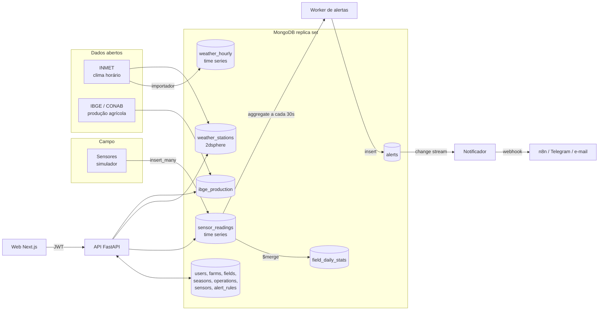

# Arquitetura

## Visão geral

## Componentes

| Componente | Tecnologia | Responsabilidade |
|---|---|---|
| `mongo` | MongoDB 7 em replica set de um nó | Persistência. Replica set é necessário para change streams |
| `mongo-init` | mongosh | Inicia o replica set e aplica schema, validações e índices (idempotente) |
| `api` | FastAPI + PyMongo async | Autenticação JWT, CRUD de fazendas e talhões, consultas e agregações |
| `web` | Next.js 16 + Tailwind 4 | Interface; consome a API |
| `simulator` | Python | Gera leituras de sensores (histórico e ao vivo) |
| `alerts` | Python | Avalia regras e notifica via change stream |
| `workers.inmet` | Python + pandas | Importa o histórico horário do INMET |
| `workers.rollup` | Python | Pré-agrega leituras por talhão e dia com `$merge` |
| `n8n` | opcional | Recebe o webhook de alerta e dispara Telegram ou e-mail |

## Fluxos

**Telemetria.** O simulador escreve em lote em `sensor_readings`. A API lê com `$group` + `$dateTrunc` para séries por hora ou dia.

**Alertas.** O worker roda a cada 30 s uma agregação por regra (média da métrica na janela). Se a condição é violada e não há alerta aberto, insere em `alerts`. Um change stream em `alerts` dispara o notificador, que registra no log e chama o webhook configurado.

**Clima e produção.** O importador grava estações (com índice 2dsphere) e o histórico horário. A API cruza o centroide do talhão com as estações via `$geoNear`.

## Decisões e trade-offs

**Change stream em `alerts`, não em `sensor_readings`.** A documentação do MongoDB diz que time series collections não suportam change streams. Por isso a detecção é feita por agregação periódica e o change stream observa uma coleção comum. Trade-off: alerta com atraso de até 30 s, em troca de um mecanismo que funciona com time series.

**Time series para leituras e clima.** Bucketing interno reduz espaço e acelera consultas por intervalo. O índice geoespacial fica fora das time series (só há suporte parcial em `metaField`), por isso os dados geográficos moram em `fields` e `weather_stations`. Também não há `$jsonSchema` nessas coleções: a validação das leituras fica no código que insere.

**TTL de 180 dias em `sensor_readings`.** Dado bruto expira; o resumo diário em `field_daily_stats` permanece. Reduz custo de armazenamento mantendo o histórico analítico.

**`$merge` para pré-agregação.** O dashboard consulta `field_daily_stats` (uma linha por talhão e dia) em vez de varrer milhões de leituras. O rollup é idempotente: reexecutar substitui os dias.

**Replica set de um nó em desenvolvimento.** Necessário para change streams e para igualar o comportamento do Atlas. Sem autenticação no ambiente local, por simplicidade; em produção use Atlas com usuário e IP allow-list.

**Simulador escreve direto no MongoDB.** Representa o gateway que agrega vários sensores. Se quiser mostrar o caminho dispositivo → API, adicione um `POST /readings/batch` com chave de dispositivo.

**FastAPI + PyMongo async.** Mantém o stack em Python, o mesmo dos workers e da análise de dados. Trade-off: duas linguagens no repositório (Python e TypeScript).

## Carga estimada

200 sensores com leitura a cada 5 minutos geram 57.600 documentos por dia, cerca de 21 milhões por ano. Com TTL de 180 dias a coleção estabiliza em torno de 10 milhões de documentos.

## O que revisitar se o sistema crescer

- Sharding de `sensor_readings` por `meta.field_id` + `ts` (o shard key de time series só aceita `metaField` e `timeField`).
- Ingestão por fila (Kafka ou MQTT) em vez de escrita direta.
- Online Archive no Atlas para dados frios.
- Avaliação de alertas orientada a eventos, em vez de polling.
