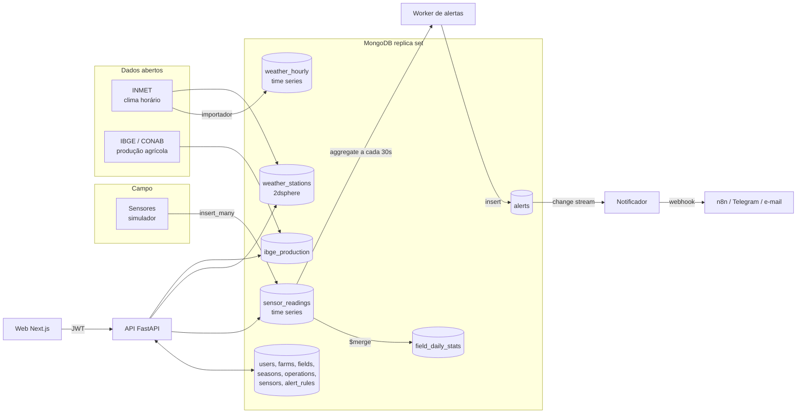

# Arquitetura

## Visão geral

## Componentes

| Componente | Tecnologia | Responsabilidade |
|---|---|---|
| `mongo` | MongoDB 7 em replica set de um nó local | Persistência local. Replica set é necessário para change streams |
| `mongo-init` | mongosh | Inicia o replica set, aplica o schema e verifica time series, TTL, índices e validações (idempotente) |
| `api` | FastAPI + PyMongo async | Autenticação JWT, CRUD de contas e recursos agrícolas, consultas e agregações |
| `web` | Next.js 16 + Tailwind 4 + Recharts + React Leaflet | Interface; consome a API |
| `simulator` | Python | Gera leituras de sensores (histórico e ao vivo) |
| `alerts` | Python | Avalia regras e notifica via change stream |
| `workers.inmet` | Python + pandas | Importa o histórico horário do INMET |
| `workers.rollup` | Python | Mantém resumos por talhão e dia com `$merge` |
| `n8n` | opcional | Recebe o webhook de alerta e dispara Telegram ou e-mail |

## Ambientes de desenvolvimento e produção

O Compose principal sobe a stack integrada. Para trabalhar com agentes em frentes independentes, há manifests separados: `docker-compose.web.yml` conecta o Next.js a uma Mock API com dados previsíveis; `docker-compose.api.yml` e `docker-compose.workers.yml` cada um têm seu próprio MongoDB e projeto Docker. Portas e volumes não se sobrepõem aos da stack integrada.

O Compose de workers executa `demo-seed` uma vez após a inicialização do schema; esse seed idempotente fornece sensores e regras para a simulação isolada. O Compose de API pode ser preenchido separadamente com `make api-seed`.

Para uma demonstração pública opcional, `render.yaml` e `Dockerfile.render` configuram API e workers num único serviço Web Docker; a interface Next.js é publicada separadamente e usa o Atlas Free. Esse processo combinado atende ao limite de uma instância gratuita e reinicia workers que falharem. A Render hiberna o serviço sem tráfego, então a telemetria e a avaliação de alertas também param durante esse período. O TTL hospedado é configurável e começa em 30 dias. Não há SLA ou promessa de disponibilidade contínua. `docker-compose.prod.yml` é uma alternativa self-hosted para quem já dispõe de VM própria; não é necessária no fluxo sem custo.

## Fluxos

**Telemetria.** O simulador escreve em lote em `sensor_readings`. A API lê com `$group` + `$dateTrunc` para séries por hora ou dia.

**Alertas.** O worker roda a cada 30 s uma agregação por regra (média da métrica na janela). Se a condição é violada e não há alerta aberto, insere em `alerts`. Um change stream em `alerts` dispara o notificador, que registra no log e chama o webhook configurado. Alertas pendentes também são verificados ao iniciar e a cada 30 s. Uma concessão temporária impede que workers concorrentes enviem o mesmo alerta ao mesmo tempo; erros no webhook liberam o alerta para nova tentativa. A entrega é pelo menos uma vez: uma falha após receber HTTP 2xx, mas antes de gravar a confirmação no MongoDB, pode gerar uma repetição. Integrações podem deduplicar usando `alert_id`. Sem webhook, o log é o canal de demonstração e o alerta fica marcado como notificado. A API só permite `resolved_at` em alertas resolvidos, rejeita datas futuras ou anteriores ao disparo, preserva a data em resoluções repetidas e remove-a ao reabrir.

**Clima e produção.** O importador grava estações (com índice 2dsphere) e o histórico horário. A API cruza o centroide do talhão com as estações via `$geoNear`, lista os anos importados e expõe observações recentes ou um ano-calendário completo da estação mais próxima. O importador do IBGE limita a carga por ano, estados e culturas; a consulta do ranking usa o ano mais recente disponível no recorte.

**Validação de entrada.** `PATCH` rejeita `null` em campos obrigatórios e permite limpar somente campos opcionais definidos pelo contrato. A API também rejeita valores não finitos em produtividade, custos e regras/alertas. Os importadores descartam medições INMET e valores SIDRA que não possam ser representados como números finitos; estações com coordenadas fora dos limites WGS84 são ignoradas.

**Conta e remoção de dados.** `PATCH /auth/me` valida a senha atual para alterar perfil, e-mail ou senha. `DELETE /auth/me` também exige a senha atual e remove as fazendas do usuário e os dados associados aos seus talhões, inclusive leituras brutas, resumos, sensores, safras, operações e alertas. A remoção de fazendas e talhões aplica a mesma limpeza em cascata.

## Decisões e trade-offs

**Change stream em `alerts`, não em `sensor_readings`.** A documentação do MongoDB diz que time series collections não suportam change streams. Por isso a detecção é feita por agregação periódica e o change stream observa uma coleção comum. Trade-off: alerta com atraso de até 30 s, em troca de um mecanismo que funciona com time series.

**Time series para leituras e clima.** Bucketing interno reduz espaço e acelera consultas por intervalo. O índice geoespacial fica fora das time series (só há suporte parcial em `metaField`), por isso os dados geográficos moram em `fields` e `weather_stations`. Também não há `$jsonSchema` nessas coleções: a validação das leituras fica no código que insere.

**TTL em `sensor_readings`.** `READINGS_TTL_DAYS` configura a retenção (180 dias local, 30 dias na produção gratuita). Dado bruto expira; os resumos em `field_daily_stats` permanecem. A API combina esses resumos com leituras brutas para gráficos diários mais longos que a retenção.

**`$merge` para pré-agregação.** O worker atualiza até oito dias por execução e grava uma linha por talhão e dia; `$merge` substitui o mesmo bucket, então a atualização é idempotente. Em produção, a janela cobre o preenchimento de lacunas limitado a sete dias e o job roda diariamente.

**Replica set de um nó em desenvolvimento.** Necessário para change streams e para igualar o comportamento do Atlas. Sem autenticação no ambiente local, por simplicidade; em produção use Atlas com usuário e IP allow-list.

**Simulador escreve direto no MongoDB.** Representa o gateway que agrega vários sensores. Se quiser mostrar o caminho dispositivo → API, adicione um `POST /readings/batch` com chave de dispositivo.

**FastAPI + PyMongo async.** Mantém o stack em Python, o mesmo dos workers e da análise de dados. Trade-off: duas linguagens no repositório (Python e TypeScript).

## Carga estimada

200 sensores com leitura a cada 5 minutos geram 57.600 documentos por dia, cerca de 21 milhões por ano. Com TTL de 180 dias a coleção estabiliza em torno de 10 milhões de documentos.

## O que revisitar se o sistema crescer

- Sharding de `sensor_readings` por `meta.field_id` + `ts` (o shard key de time series só aceita `metaField` e `timeField`).
- Ingestão por fila (Kafka ou MQTT) em vez de escrita direta.
- Online Archive no Atlas para dados frios.
- Avaliação de alertas orientada a eventos, em vez de polling.
