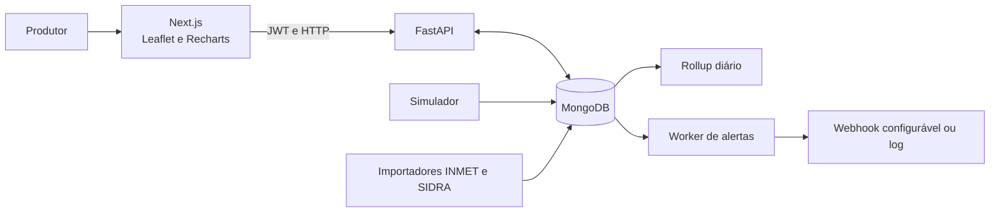
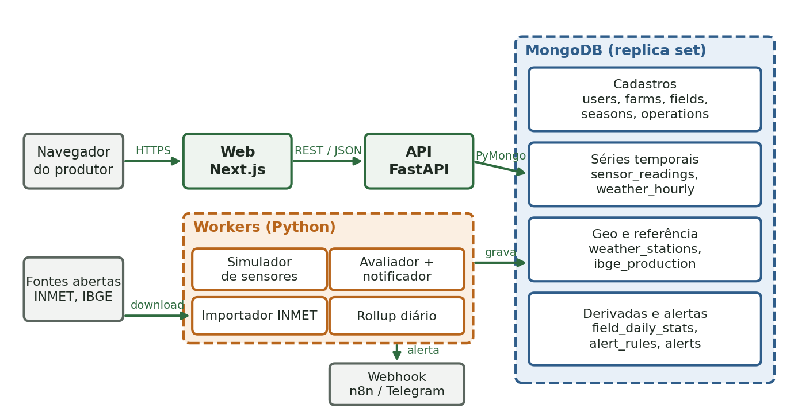
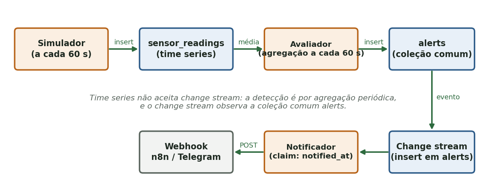
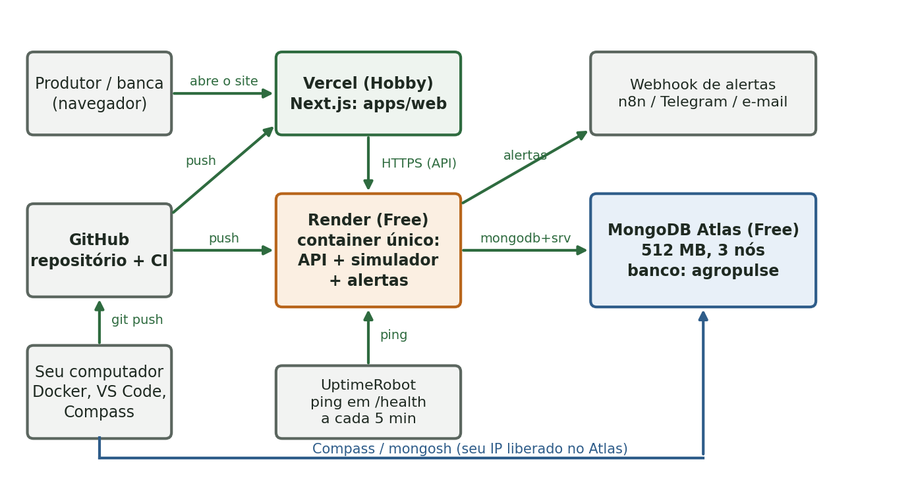

# AgroPulse — relatório técnico

> Modelo editável para a atividade IAL-215. Substitua os campos entre colchetes, anexe as evidências solicitadas e revise os resultados depois da demonstração. Não declare importações, publicação ou testes que não tenham sido realizados.

## Capa

| Identificação | Dados |
|---|---|
| Instituição | Fatec Pompéia — Shunji Nishimura |
| Disciplina | IAL-215 — Banco de Dados NoSQL |
| Projeto | AgroPulse — plataforma de monitoramento de safra |
| Professor(a) | [preencher] |
| Integrantes | Vitor Studzieski (RA pendente), Maria Fernanda Passos (RA pendente) e Lauan Alves Ferneda (RA pendente) |
| Repositório | https://github.com/Vitor-Studzieski/AgroPulse |
| Data da apresentação | [pendente] |

## Resumo

O AgroPulse é uma aplicação acadêmica para organizar fazendas, talhões, safras, operações de campo, sensores e alertas. A solução combina API em Python/FastAPI, interface em Next.js, persistência MongoDB e workers para simulação de telemetria, alertas, pré-agregação e importação de dados públicos. O ambiente local é reproduzível com Docker Compose e constitui o caminho de demonstração sem custo incremental. A disponibilidade de qualquer hospedagem gratuita é de melhor esforço.

**Palavras-chave:** MongoDB, FastAPI, Next.js, séries temporais, GeoJSON, agronegócio.

## 1. Introdução

O acompanhamento de uma safra reúne dados de propriedade, limites geográficos, atividades de campo, sensores e clima. O projeto organiza esses dados em uma aplicação única para apoiar a consulta e a demonstração de operações agrícolas. Este relatório descreve a arquitetura, a modelagem, a implementação e as evidências produzidas pelo grupo.

## 2. Objetivos

### 2.1 Objetivo geral

Construir uma plataforma acadêmica reproduzível para cadastro e acompanhamento de fazendas e talhões, com telemetria, séries históricas, alertas e contexto climático e produtivo.

### 2.2 Objetivos específicos

- Implementar autenticação JWT e operações protegidas por propriedade dos dados.
- Disponibilizar CRUD de fazendas, talhões, safras, operações, sensores e regras/alertas.
- Persistir telemetria em coleção MongoDB time series e calcular séries e resumos.
- Apresentar talhões em mapa GeoJSON e métricas em gráficos horários e diários.
- Importar dados públicos do INMET e da PAM/SIDRA com recortes limitados.
- Reproduzir a execução local, os testes e a validação do schema com ferramentas gratuitas.

## 3. Tecnologias e justificativas

| Tecnologia | Uso no projeto | Justificativa |
|---|---|---|
| MongoDB | Persistência, documentos, índices geoespaciais, time series e agregações | Atende aos requisitos de dados sem esquema relacional fixo e demonstra recursos NoSQL |
| Python e FastAPI | API, modelos e validação | Implementação tipada de rotas HTTP e contratos OpenAPI |
| PyMongo assíncrono | Acesso da API ao MongoDB | Mantém I/O de banco assíncrono na API |
| Python e pandas | Workers e importadores | Reaproveita a linguagem para ingestão, simulação e transformação |
| Next.js e React | Interface do produtor | Organiza a experiência web em componentes e páginas |
| Leaflet e React Leaflet | Mapa dos talhões | Exibe polígonos GeoJSON e permite desenhar limites |
| Recharts | Gráficos de telemetria | Renderiza séries horárias e diárias integradas à interface React |
| Docker Compose | Ambiente local integrado e ambientes isolados | Permite iniciar dependências e serviços com configuração versionada |
| MongoDB Atlas | Alternativa de persistência remota ilustrada no plano de produção do guia | Foi documentada como opção; esta versão foi verificada com MongoDB local e não foi publicada no Atlas |
| Render | Alternativa descrita pelo guia para hospedar API e workers | O Blueprint e a imagem estão preparados, mas não foram implantados; a demonstração usa Docker Compose local |
| Vercel | Alternativa descrita pelo guia para hospedar a interface Next.js | O front-end foi compilado localmente; não foi publicado na Vercel |
| GitHub Actions | CI | Automatiza lint, testes, build, schema e manifests em push e pull request |

## 4. Arquitetura

O sistema é composto por interface, API, workers e MongoDB. A API valida entradas e aplica autorização por proprietário. Os workers escrevem telemetria e processam alertas e resumos. A interface consome a API com JWT.

O diagrama detalhado está em [docs/ARQUITETURA.md](ARQUITETURA.md). A execução em nuvem não é pré-requisito da demonstração: este checkout não foi publicado em serviços externos.

### 4.1 Figuras de arquitetura exigidas pelo guia

As três figuras abaixo foram extraídas do guia da atividade e são reproduzidas como **arquiteturas de referência**. Elas explicam a proposta do trabalho; não comprovam publicação em nuvem. No protótipo executado, a avaliação de alertas ocorre a cada 30 segundos e, sem webhook configurado, a notificação fica no log local.

*Figura 1 — Arquitetura lógica do AgroPulse. Fonte: Guia Completo de Engenharia, Infraestrutura e Arquitetura do AgroPulse, seção 3.1, p. 8.*

*Figura 2 — Fluxo do dado do sensor à notificação. Fonte: Guia Completo de Engenharia, Infraestrutura e Arquitetura do AgroPulse, seção 3.3, p. 9.*

*Figura 3 — Ambiente de produção do Plano A. Fonte: Guia Completo de Engenharia, Infraestrutura e Arquitetura do AgroPulse, seção 11, p. 25. A implantação Render/Atlas/Vercel/UptimeRobot não foi realizada neste projeto; a demonstração verificada permanece local e sem custo incremental.*

## 5. Modelagem NoSQL

O banco `agropulse` usa documentos para cadastros e coleções time series para leituras de sensores e clima. As coleções `fields` e `weather_stations` possuem geometria GeoJSON e índices `2dsphere`. Leituras possuem TTL configurável e resumos diários em `field_daily_stats` preservam agregados para gráficos.

| Coleção | Finalidade | Decisão de modelagem | Recurso MongoDB demonstrado |
|---|---|---|---|
| `users`, `farms` | Contas e propriedades | Documentos separados; cada fazenda referencia seu proprietário por `owner_id`, permitindo CRUD e autorização independentes | Validação, índice único de e-mail, índice por proprietário e GeoJSON `Point` com `2dsphere` |
| `fields` | Talhões e polígonos | Documento próprio por talhão; referencia `farm_id` e mantém `boundary`, `centroid` e atributos atuais juntos | GeoJSON `Polygon`, validação de geometria e índices `2dsphere` |
| `seasons`, `operations` | Safras e diário de campo | Documentos separados e referenciados por `field_id`/`season_id`; detalhes variáveis da operação ficam embutidos em `details` | Índices de consulta por talhão e data, validação e filtros por proprietário |
| `sensors`, `alert_rules`, `alerts` | Dispositivos, regras e eventos | Cada recurso tem ciclo de vida próprio e referencia talhão/regra; o evento registra uma cópia dos valores medidos no disparo | Índices únicos, consultas de estado e change stream na coleção comum `alerts` |
| `sensor_readings` | Medições dos sensores | Uma medição por documento em série temporal; `meta` embute os IDs estáveis de sensor, talhão e fazenda para filtrar sem consultas de junção | Time series por `ts`, índices por `meta` e TTL configurável |
| `weather_stations`, `weather_hourly` | Estações e clima do INMET | Cadastro da estação separado das medições; as observações referenciam a estação por código em seus metadados | GeoJSON `Point` com `2dsphere` e time series horária |
| `ibge_production` | Produção agrícola municipal | Um documento independente por município, cultura e ano, sem uma lista embutida de anos | Índice único composto por município, cultura e ano |
| `field_daily_stats` | Resumos diários | Um documento derivado por talhão e dia; referencia o talhão e preserva medidas agregadas após a retenção das leituras brutas | Agregação `$group`, escrita repetível com `$merge` e índice único por `field_id,day` |

O documento [docs/MODELO-DADOS.md](MODELO-DADOS.md) contém campos, índices, exemplos e consultas para a demonstração. No endpoint de talhões, coordenadas WGS84 e anéis GeoJSON são validados; área e centroide são calculados no servidor.

## 6. Funcionalidades implementadas

| Requisito | Descrição | Evidência a anexar |
|---|---|---|
| RF01 | Cadastro, login e sessão JWT | 01-login e 09-swagger |
| RF02 | CRUD de fazendas com localização | 02-fazendas |
| RF03 | CRUD de talhões, polígonos, área e centroide | 03-talhoes e 04-mapa |
| RF04 | CRUD de safras por talhão | 06-safras |
| RF05 | CRUD de operações de campo | 07-operacoes |
| RF06 | Últimas leituras e séries por hora ou dia | 05-grafico-umidade e 23-documento-sensor-reading |
| RF07 | Regras, histórico de alertas e webhook opcional | 08-alertas e 14-codigo-change-stream |
| RF08 | Importador INMET e consulta da estação próxima | A amostra oficial compacta da estação A763/Marília está versionada em `data/imports/inmet-sp-a763-2024.zip` e é carregada por `make demo` (8.784 observações). A API autenticada e a interface posicionam a estação a 27,8 km do campus; quando não há observações nos últimos sete dias, o painel seleciona o ano importado mais recente e mostra o histórico anual. O ZIP oficial completo de 2024 também foi importado em MongoDB descartável, com 40 estações e 351.360 leituras. Anexar captura reproduzida pelo grupo |
| RF09 | Importador SIDRA/PAM e ranking municipal | CSV oficial da PAM/SIDRA 2023 para os 645 municípios de SP em `data/imports/pam-sp-2023.csv`; 1.556 registros completos importados no Mongo local (480 soja, 564 milho, 512 cana), incluindo Pompéia. API autenticada e painel exibiram o ranking de soja de SP. |
| RF10 | Painel, mapa, clima e ranking | Capturas das telas correspondentes |

A interface Next.js autentica pela API FastAPI e oferece o painel e os formulários dos recursos agrícolas. A API verifica o vínculo entre usuário e fazenda antes de operar sobre os dados. Os workers simulam leituras, avaliam regras, enviam webhooks quando configurados e importam dados públicos. Sem webhook, o sistema registra a entrega do alerta no log local. O roteiro detalhado das telas e da apresentação está em [docs/ROTEIRO-APRESENTACAO.md](ROTEIRO-APRESENTACAO.md); 14 capturas finais das 28 previstas estão em `docs/evidencias/`, além de uma imagem complementar do painel. As outras 14 capturas seguem pendentes no checklist do apêndice A.

## 7. Testes e verificações

Preencha esta seção com a execução mais recente e anexe as capturas indicadas no checklist. No estado atual do repositório, as suítes locais de API e workers, o build de produção da interface e os manifests/builds locais foram executados. Existe um workflow remoto verde no `main` para o commit base `6d69f43`; ele não inclui as alterações locais sem commit deste worktree.

| Verificação | Resultado observado | Data / evidência |
|---|---|---|
| Ruff e pytest da API | Aprovados; 52 testes | Validação local em 2026-10-31; anexar log/captura |
| Ruff e pytest dos workers | Aprovados; 18 testes | Validação local em 2026-10-30; anexar log/captura |
| Build de produção do Next.js | Aprovado | Validação local em 2026-10-30; anexar log/captura |
| Schema aplicado e verificado em MongoDB limpo | Aprovado; duas coleções time series, TTL de 30 dias, índices essenciais, plano `IXSCAN` e rejeição sem persistência de documento inválido | MongoDB 7 descartável em 2026-10-31; anexar 12-schema-js e 17-validacao-erro |
| Compose e smoke tests locais | Os três ambientes isolados iniciaram; endpoints de saúde e documentação responderam | Validação local; anexar log/captura |
| Demonstração em banco vazio | `make demo` em projeto Compose isolado criou seed, 3 talhões e 6 sensores; backfill gerou 12.096 leituras sintéticas de sete dias; importou INMET A763 (8.784 leituras) e PAM/SP (1.556 registros); o rollup criou 24 documentos em `field_daily_stats`. A API autenticada retornou clima 2024 e top 10 do ranking 2023. A segunda execução manteve as contagens, sem backfill duplicado ou resumos diários duplicados. | 2026-10-30; validação repetida em projeto isolado e volumes temporários removidos após a conferência |
| Fluxo CRUD integrado | Cadastro/login, recursos agrícolas, telemetria simulada, alerta avaliado pelo worker e exclusão da conta temporária concluídos; token revogado retornou 401 | Stack local isolada, 2026-10-30; conta descartável removida, anexar captura se exigida |
| GitHub Actions remoto | A execução de `main` passou em 2026-10-30 nos jobs schema, workers, api, web e compose; o branch local ainda não foi publicado | Run #1 do commit base `6d69f43`; capturar o CI da versão entregue após publicação autorizada |

## 8. Demonstração

1. Inicie o ambiente local conforme as instruções de [README.md](../README.md).
2. Entre com a conta de demonstração criada pelo seed.
3. Apresente o mapa usando somente o campus da Fatec Pompéia como referência geográfica (`-22.1110`, `-50.1994`). Explique que os polígonos próximos são sintéticos e não representam limites oficiais ou talhões reais do campus.
4. Mostre fazendas, talhões no mapa, gráfico e cadastros de safras e operações. No painel climático, selecione um ano importado — `2024` para reproduzir o ZIP oficial validado — e indique a data da observação exibida.
5. Mostre uma regra e um alerta gerado pelo worker; sem webhook, a entrega de demonstração aparece no log.
6. No MongoDB Compass, mostre coleções, time series, índices, validação e agregação diária.
7. Mantenha o ambiente local como plano para a apresentação. A stack, o seed e o ranking ficam no computador; sem internet, os tiles do OpenStreetMap podem não carregar o fundo cartográfico.

## 9. Custo, limitações e trabalhos futuros

O fluxo de desenvolvimento e demonstração usa Docker Compose local e bibliotecas de código aberto. Não foi realizado deploy externo. As cotas e condições de serviços gratuitos podem mudar; nenhum serviço que peça cartão, trial, pagamento ou upgrade deve ser habilitado para cumprir a meta de R$ 0.

Limitações verificadas ou pendentes de evidência:

- A hospedagem gratuita, caso o grupo a configure, não garante execução contínua nem SLA.
- Na validação descartável sem volume, o ZIP oficial do INMET 2024 foi importado com filtro SP após aplicação de `infra/mongo/02-schema.js`: 40 estações e 351.360 observações. A amostra compacta versionada conserva somente o arquivo oficial da A763/Marília (8.784 leituras). `make demo` a carrega para que a demonstração anual funcione em um clone limpo; a API e o painel mostraram A763 a 27,8 km do campus e a última observação em 31/12/2024 23:00 UTC (20:00 no horário local). Ainda falta anexar a captura acadêmica.
- A fixture SIDRA oficial de Sorriso (MT), ano 2023, valida leitura e parsing e foi importada em um MongoDB temporário sem volume persistente; foram conferidos três documentos (soja, milho e cana). Repetir ou fotografar essa consulta no ambiente de demonstração do grupo, se exigido.
- A amostra oficial da PAM/SIDRA 2023 para SP está versionada em `data/imports/pam-sp-2023.csv` e é carregada por `make demo` sem consulta externa. O gerador consultou as APIs oficiais e reproduziu o CSV versionado byte a byte. O importador persistiu 1.556 combinações municipais completas; a API autenticada retornou o top 10 de soja por produtividade e o painel exibiu Pompéia na referência oficial regional. Isso não altera a demonstração espacial, que permanece limitada ao campus e a polígonos sintéticos próximos.
- O remoto público `https://github.com/Vitor-Studzieski/AgroPulse` foi confirmado a partir do origin do GitHub. A branch local `feature/agropulse-completion` ainda não foi publicada; faltam os RAs e a data da apresentação para fechar a versão acadêmica final.

Como trabalhos futuros, podem ser considerados autenticação de dispositivos e ingestão por gateway, exportação do relatório de safra e avaliação com uma carga de dados maior, preservando os limites financeiros definidos.

## 10. Conclusão

O AgroPulse reúne CRUD agrícola, persistência MongoDB, telemetria, geodados, análises e workers em uma solução local reproduzível. A conclusão acadêmica depende de executar o roteiro, anexar as 14 capturas finais restantes, completar os RAs e confirmar a data da apresentação.

## Referências

- *AgroPulse: Guia Completo de Engenharia, Infraestrutura e Arquitetura*. Versão de 30/10/2026, seções 3, 7 e 14.
- Instituto Brasileiro de Geografia e Estatística. [API SIDRA, tabela 5457 — Produção Agrícola Municipal](https://apisidra.ibge.gov.br/values/t/5457).
- Instituto Brasileiro de Geografia e Estatística. [API de Localidades — municípios de São Paulo](https://servicodados.ibge.gov.br/api/v1/localidades/estados/35/municipios?orderBy=nome), usada para delimitar o recorte da amostra.
- Instituto Nacional de Meteorologia. [Dados históricos de estações automáticas](https://portal.inmet.gov.br/dadoshistoricos/).
- Documentação oficial do MongoDB, FastAPI, Next.js, Leaflet e Recharts.

## Apêndice A — evidências

Use os nomes previstos pelo guia e marque o estado após incluir cada arquivo em `docs/evidencias/`:

| Nº | Nome | Capturado |
|---:|---|---|
| 01 | `01-login.png` | [x] |
| 02 | `02-fazendas.png` | [x] |
| 03 | `03-talhoes.png` | [x] |
| 04 | `04-mapa.png` | [x] |
| 05 | `05-grafico-umidade.png` | [x] |
| 06 | `06-safras.png` | [x] |
| 07 | `07-operacoes.png` | [x] |
| 08 | `08-alertas.png` | [x] |
| 09 | `09-swagger.png` | [x] |
| 10 | `10-codigo-insert-talhao.png` | [x] |
| 11 | `11-codigo-insert-many.png` | [x] |
| 12 | `12-schema-js.png` | [x] |
| 13 | `13-codigo-merge.png` | [x] |
| 14 | `14-codigo-change-stream.png` | [x] |
| 15 | `15-count-leituras.png` | [ ] |
| 16 | `16-getcollectioninfos-timeseries.png` | [ ] |
| 17 | `17-validacao-erro.png` | [ ] |
| 18 | `18-explain-ixscan.png` | [ ] |
| 19 | `19-geointersects.png` | [ ] |
| 20 | `20-agregacao-media-diaria.png` | [ ] |
| 21 | `21-compass-colecoes.png` | [ ] |
| 22 | `22-documento-fields.png` | [ ] |
| 23 | `23-documento-sensor-reading.png` | [ ] |
| 24 | `24-indices-fields.png` | [ ] |
| 25 | `25-validacao-farms.png` | [ ] |
| 26 | `26-field-daily-stats.png` | [ ] |
| 27 | `27-github-repo.png` | [ ] |
| 28 | `28-github-actions-verde.png` | [ ] |
